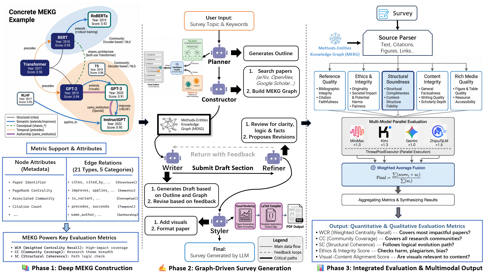
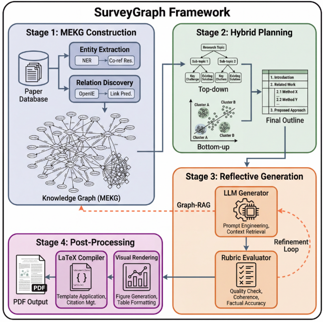
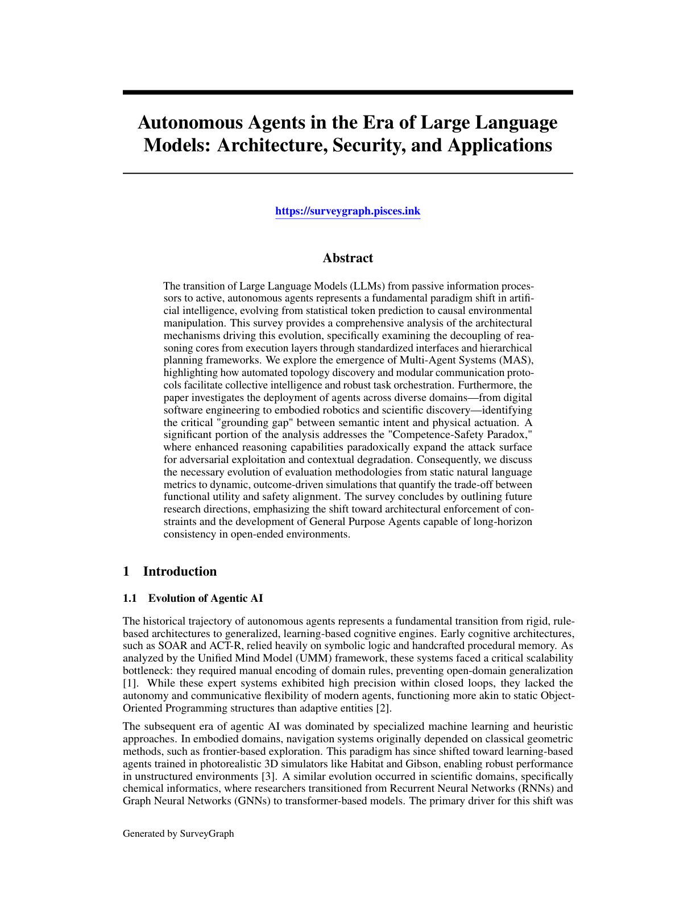
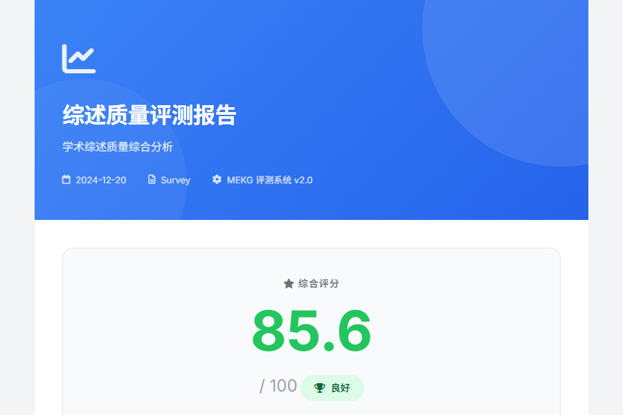

<div align="center">


# SurveyGraph: Generating Academic Surveys via Methods-Entity Knowledge Graphs

**Yifan Yuan** · **Yancheng Zhu** · **Zuoyu Zhang** · **Xiaogang Peng**<sup>&dagger;</sup>

School of Artificial Intelligence, Shenzhen University
<br>
<sup>&dagger;</sup>Corresponding author

**EMNLP 2026 Findings**

<a href="https://arxiv.org/abs/2610.31317"></a>
<a href="requirements.txt"></a>
<a href="LICENSE"></a>

[English](README.md) · [简体中文](README_zh.md)

</div>

<p align="center"><br><em>SurveyGraph: MEKG construction, graph-driven survey generation, and integrated evaluation.</em></p>

**TL;DR:** LLM survey generators usually retrieve papers as a flat pile of documents, so the result reads like a collage of summaries. A good survey explains how a field evolved — which work extends which, which methods compete, which benchmarks mark turning points. **SurveyGraph** builds a **Methods-Entity Knowledge Graph (MEKG)** that records method-level *follow-on*, *competition* and *shared-resource* relations, and uses it as the backbone for core-paper discovery, graph-aware retrieval, hybrid outlining and evidence-gated, evolution-aware writing. Graph-aware retrieval **nearly doubles recall** over flat lexical baselines (p = 0.004), and **80.6%** of generated sentences are fully or partly supported by the papers they cite.

## 🔍 Method

<p align="center"></p>

| Stage | What happens | Code |
|:-|:-|:-|
| **MEKG construction** | Collect and parse papers (OpenAlex, arXiv, uploaded PDFs); extract methods, models, tasks, datasets and metrics; infer typed relations (*extends*, *improves*, *applies*, competition, shared resources) and filter them with a semantic evidence gate; rank core papers by graph centrality | `mekg/`, `src/` |
| **Hybrid outline planning** | Fuse a top-down topic skeleton with bottom-up themes from graph communities and core papers, refined by an outline critic | `mekg/`, `src/` |
| **Reflective generation** | Graph-aware retrieval and evidence gating per section, evolution-aware narrative synthesis, and a reflection loop that checks structure, factual support and citation grounding | `src/` |
| **Post-processing & evaluation** | Figures, tables and LaTeX/PDF assembly; evaluation of structure, content, references, ethics/integrity and visual quality with an HTML report | `src/`, `evaluation/` |

## 🛠️ Installation

```bash
git clone https://github.com/MUSE-AI-Lab/SurveyGraph.git
cd SurveyGraph
python -m venv .venv && source .venv/bin/activate      # Windows: .venv\Scripts\Activate.ps1
pip install -r requirements.txt
```

Python 3.10–3.12 is tested. Optional components are enabled only when needed: [Memgraph](https://memgraph.com/) as graph database, a LaTeX toolchain for PDF output, MinerU for PDF parsing, and MySQL for the web frontend.

**Providers.** Copy `.env.example` to `.env` (ignored by git) and fill in what your run needs — `REMOTE_URL` + `TOKEN` or a provider key such as `OPENAI_API_KEY` / `DASHSCOPE_API_KEY`, optionally an embedding endpoint (`EMBED_*`) and `OPENALEX_EMAIL`. Offline tests need no credentials.

## 🚀 Quick Start

Generate a survey for a topic (papers are collected automatically):

```bash
python tasks/mekg_run.py --topic "Retrieval-Augmented Generation" --max_papers 30 \
    --year_start 2022 --year_end 2024 --no-memgraph --no-evaluation
```

Every intermediate result is saved under `outputs/<task_id>/` (`mekg/`, `papers/`, `latex/`, `logs/`, `task_config.json`), so an interrupted run can be resumed:

```bash
python tasks/mekg_run.py --list-tasks
python tasks/mekg_run.py --resume --task_id <task_id>
```

Useful switches: `--uploaded-files '["a.pdf", "b.pdf"]'` and `--no-arxiv` to write from your own papers, `--no-reflection` / `--no-hybrid-outline` / `--no-global-reflector` for ablations, and dropping `--no-evaluation` to score the result at the end. See `python tasks/mekg_run.py --help` for all options.

## 📊 Evaluation

```bash
python evaluation/main.py --help         # quality evaluators and HTML report
python experiments/run_suite.py --help   # ablations, matched baselines, probes and evidence audits
```

**Seven-method equal-budget retrieval benchmark** (top-5, Table 2 of the paper). R@5 / P@5: recall and precision; Str.: section–evidence alignment; Den.: typed relation density; CoCit: co-citation connectivity measured with OpenAlex, independent of MEKG.

| Method | R@5 | P@5 | Str. | Den. | CoCit |
|:-|:-:|:-:|:-:|:-:|:-:|
| Flat lexical | .252 | .132 | **.558** | .134 | .089 |
| Bibliographic RRF | .309 | .194 | .530 | .132 | .142 |
| TF-IDF GraphRAG | .347 | .176 | .485 | .140 | .118 |
| MEKG typed | .153 | .089 | .392 | **.228** | .156 |
| Safe fusion | .261 | .134 | .528 | .179 | .147 |
| Biblio + TF-IDF | **.357** | **.200** | .498 | .134 | .131 |
| Biblio + MEKG | .304 | .178 | .486 | .174 | **.163** |

Graph-free methods reach higher raw recall but almost no typed structure; MEKG-linked fusion keeps competitive recall while nearly doubling relation density and co-citation connectivity. Further results: graph-aware retrieval nearly doubles recall over flat lexical baselines on the graph-native core diagnostic (p = 0.004); the semantic evidence gate reaches AUC = 0.75; citation audits over 160 generated sentences find 80.6% anchored-or-partial support; human validation of 108 semantic edges confirms 68.5% supported-or-partial (Cohen's κ = 0.64).

<table>
<tr>
<td width="45%"><p align="center"><em>First page of a generated survey</em></p></td>
<td width="55%"><p align="center"><em>HTML evaluation report</em></p></td>
</tr>
</table>

Scores depend on the corpus, provider and evaluator models; the images are display examples, not benchmark claims.

## 🖥️ Web Frontend (optional)

A FastAPI service for task management and result browsing (needs a MySQL-compatible database):

```bash
pip install -r frontend/requirements.txt
python frontend/run.py --reload          # binds to 127.0.0.1; set JWT_SECRET and CORS before sharing
```

## 📁 Repository Structure

```text
tasks/mekg_run.py   # end-to-end entry point (collection → MEKG → outline → writing → LaTeX → evaluation)
mekg/               # Methods-Entity Knowledge Graph pipeline
src/                # retrieval, generation, refinement, schemas and shared config
evaluation/         # quality evaluators and HTML report
experiments/        # ablations, matched baselines, probes and evidence audits
frontend/           # optional FastAPI service
resources/          # prompts, templates and static resources
tests/              # unit tests and public-release checks
docs/               # design notes and figures
scripts/            # release staging, packaging and validation
```

Downloaded papers, corpora, generated databases and provider credentials are not part of the repository; `python -m pytest -q tests/test_public_release.py` and `python scripts/check_public_release.py` audit the public tree (they need `git` on `PATH`). See [`docs/PUBLIC_RELEASE_BOUNDARY.md`](docs/PUBLIC_RELEASE_BOUNDARY.md).

## 📝 Citation

```bibtex
@inproceedings{yuan2026surveygraph,
  title     = {{SurveyGraph}: Generating Academic Surveys via Methods-Entity Knowledge Graphs},
  author    = {Yuan, Yifan and Zhu, Yancheng and Zhang, Zuoyu and Peng, Xiaogang},
  booktitle = {Findings of the Association for Computational Linguistics: EMNLP 2026},
  year      = {2026},
  eprint    = {2610.31317},
  archivePrefix = {arXiv}
}
```

## 📄 License

[MIT](LICENSE). Third-party dependencies, provider services and user-supplied data remain subject to their own licenses and terms.
