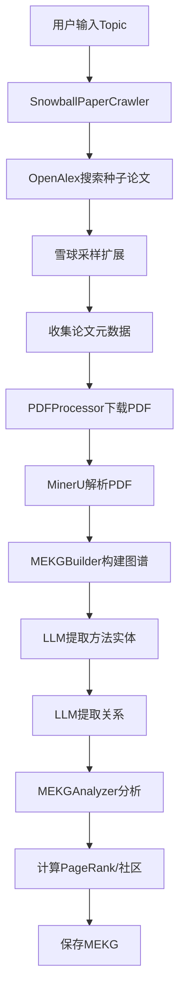
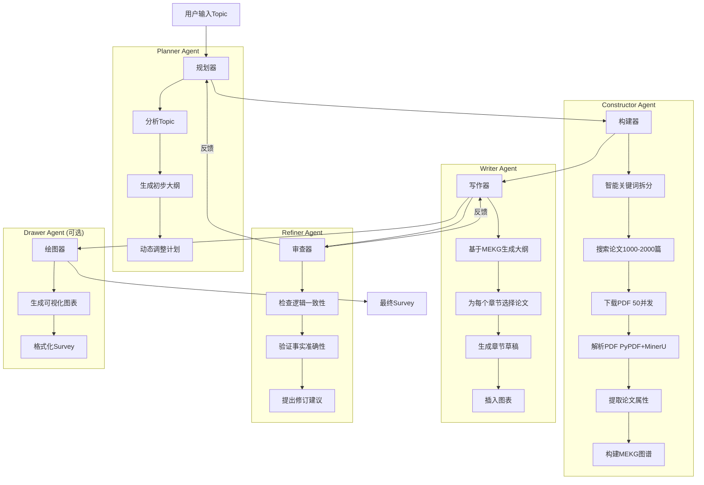

# MEKG知识图谱架构分析与改进方案

> **目标**: 构建严谨的MEKG知识图谱，支持CCFA类论文发表
> **作者**: Kilo Code
> **日期**: 2025-11-16

## 📋 目录
1. [现有架构分析](#1-现有架构分析)
2. [需求对比与差距](#2-需求对比与差距)
3. [详细改进方案](#3-详细改进方案)
4. [多智能体协作架构](#4-多智能体协作架构)
5. [实施路线图](#5-实施路线图)
6. [关键技术决策](#6-关键技术决策)

---

## 1. 现有架构分析

### 1.1 当前MEKG构建流程



### 1.2 现有组件功能

#### ✅ 已实现的功能

| 组件 | 功能 | 状态 |
|------|------|------|
| [`SnowballPaperCrawler`](src/modules/paper_acquisition/paper_crawler.py) | 雪球采样爬取论文 | ✅ 完整 |
| [`PDFProcessor`](src/modules/paper_acquisition/pdf_processor.py) | PDF下载与解析 | ⚠️ 部分完成 |
| [`MEKGBuilder`](src/modules/mekg/builder.py) | 图谱构建主流程 | ✅ 完整 |
| [`LLMRelationExtractor`](src/modules/mekg/relation_extractor.py) | LLM关系抽取 | ✅ 完整 |
| [`MEKGAnalyzer`](src/modules/mekg/analyzer.py) | 图谱分析 | ✅ 完整 |
| [`MEKGGraph`](src/modules/mekg/data_structures.py) | 数据结构 | ✅ 完整 |

#### 🔍 现有流程详解

**步骤1: 论文爬取** ([`paper_crawler.py:72-131`](src/modules/paper_acquisition/paper_crawler.py:72))
```python
# 当前实现：
1. 用户输入query → 直接搜索OpenAlex
2. 获取seed_count篇种子论文（按引用量排序）
3. 雪球采样扩展到max_papers篇
4. 过滤条件：min_citations、year_range、有效标题/摘要
```

**步骤2: PDF处理** ([`pdf_processor.py:57-94`](src/modules/paper_acquisition/pdf_processor.py:57))
```python
# 当前实现：
1. 并行下载PDF（max_concurrent=5）
2. MinerU解析（标记为pending，未实际调用）
3. 保存增强元数据
```

**步骤3: 图谱构建** ([`builder.py:60-99`](src/modules/mekg/builder.py:60))
```python
# 当前实现：
1. 加载论文元数据和引用关系
2. 创建MEKGNode节点
3. LLM提取方法实体（使用标题+摘要或全文）
4. LLM批量提取关系（基于引用网络候选）
5. 计算图属性（PageRank、社区、中心性）
6. 保存MEKG
```

**步骤4: 关系抽取** ([`relation_extractor.py:154-257`](src/modules/mekg/relation_extractor.py:154))
```python
# 当前Prompt策略：
- 系统提示词定义5种关系类型
- 用户提示词包含：源论文 + 候选论文列表（最多10篇）
- 输出JSON格式：relations列表
- 置信度基于文本证据明确程度
```

---

## 2. 需求对比与差距

### 2.1 核心需求清单

| 需求项 | 当前状态 | 差距 |
|--------|---------|------|
| **1. 智能关键词拆分** | ❌ 缺失 | 需要LLM判断是否拆分query |
| **2. 大规模论文收集(1000-2000篇)** | ⚠️ 部分支持 | 当前max_papers可配置，但需优化搜索策略 |
| **3. PDF全文下载与验证** | ⚠️ 部分实现 | 需要验证PDF可访问性，添加重试机制 |
| **4. PDF独立存储目录** | ❌ 缺失 | 当前存储在output同目录，需要独立目录 |
| **5. 多种解析方案(PyPDF+MinerU)** | ⚠️ 仅MinerU框架 | 需要实现PyPDF快速解析作为主方案 |
| **6. 解析文本独立存储** | ❌ 缺失 | 需要单独保存解析后的文本 |
| **7. 50线程并发处理** | ❌ 缺失 | 当前仅5并发，需要大幅提升 |
| **8. 断点续传机制** | ❌ 缺失 | 需要保存进度，支持中断恢复 |
| **9. 专业论文属性提取Prompt** | ⚠️ 基础实现 | 需要更详细的Prompt提取Node Attributes |
| **10. 使用便宜模型(DeepSeek-V3.2)** | ⚠️ 可配置 | 当前默认GLM-4.6，需要切换 |
| **11. 基于属性对比构建关系** | ⚠️ 基于全文 | 需要改为基于提取的属性对比 |
| **12. 替代RAG的大纲生成** | ❌ 缺失 | 需要基于MEKG的大纲生成器 |
| **13. 多智能体协作** | ❌ 缺失 | 需要设计Planner/Constructor/Writer/Refiner |

### 2.2 关键差距详解

#### 🔴 差距1: 智能关键词处理
**现状**: 直接使用用户输入的topic搜索  
**需求**: LLM判断是否需要拆分，拆分后分别搜索  
**影响**: 可能遗漏相关论文，覆盖不全面

#### 🔴 差距2: 论文数量与质量
**现状**: 雪球采样可达500篇，但搜索策略单一  
**需求**: 确保1000-2000篇高质量论文  
**影响**: 图谱规模不足，影响后续分析

#### 🔴 差距3: PDF处理能力
**现状**: 
- 并发度低(5)
- 无PDF可访问性验证
- 无断点续传
- MinerU未实际调用

**需求**:
- 50线程并发
- PDF链接验证
- 断点续传
- PyPDF快速解析 + MinerU备选

**影响**: 处理速度慢，容错性差

#### 🔴 差距4: 论文属性提取
**现状**: 仅提取method_entities  
**需求**: 提取完整的Node Attributes(记得用英文):
```python
{
    "paper_type": "Method/Survey/应用论文",
    "has_method": True/False,
    "method_name": "具体方法名称",
    "innovations": ["创新点1", "创新点2"],
    "limitations": ["不足1", "不足2"],
    "atomic_facts": ["Fact1", "Fact2"],
    "cited_papers": ["引用的关键文献"],
    "research_domain": ["领域1", "领域2"],
    # Node Attributes (Metadata)
    "pagerank_centrality": 0.0,  # 由analyzer计算
    "community_id": 0,  # 由analyzer计算
    "citation_count": 100
    ......
}
```

#### 🔴 差距5: 关系构建策略
**现状**: 基于全文内容提取关系  
**需求**: 基于提取的属性对比构建关系  
**优势**: 更高效、更准确、token消耗更少

#### 🔴 差距6: 多智能体架构
**现状**: 单一流程，无智能体协作  
**需求**: 
- **Planner**: 动态规划，生成大纲
- **Constructor**: 调用工具，构建MEKG
- **Writer**: 基于大纲和图谱生成草稿
- **Refiner**: 审查和修订

---

## 3. 详细改进方案

### 3.1 智能关键词拆分与搜索策略

#### 设计方案

```python
class IntelligentQueryProcessor:
    """智能查询处理器"""
    
    async def process_query(self, topic: str) -> List[str]:
        """
        判断是否需要拆分关键词
        
        Args:
            topic: 用户输入的主题
        
        Returns:
            搜索关键词列表
        """
        # 步骤1: LLM判断是否需要拆分
        prompt = f"""
你是一个学术搜索专家。请分析以下研究主题是否需要拆分为多个关键词进行搜索。

**主题**: {topic}

**判断标准**:
1. 如果主题清晰、具体、单一概念 → 不需要拆分
2. 如果主题模糊、宽泛、包含多个概念 → 需要拆分

**输出格式**(JSON):
{{
  "need_split": true/false,
  "reason": "判断理由",
  "keywords": ["关键词1", "关键词2", ...]  // 如果need_split=true，提供2-4个关键词
}}

**示例**:
- "BERT" → {{"need_split": false, "keywords": ["BERT"]}}
- "large language model agents" → {{"need_split": true, "keywords": ["large language model", "LLM agents", "autonomous agents"]}}
"""
        
        response = await self.llm_call(prompt)
        result = json.loads(response)
        
        if result["need_split"]:
            logger.info(f"关键词拆分: {topic} → {result['keywords']}")
            return result["keywords"]
        else:
            logger.info(f"关键词无需拆分: {topic}")
            return [topic]
    
    async def multi_keyword_search(
        self,
        keywords: List[str],
        target_count: int = 1500
    ) -> List[Dict[str, Any]]:
        """
        多关键词搜索并去重
        
        策略:
        1. 为每个关键词分配论文配额（target_count / len(keywords)）
        2. 并行搜索
        3. 按引用量排序，去重
        4. 确保总数达到target_count
        """
        quota_per_keyword = target_count // len(keywords)
        
        # 并行搜索
        tasks = [
            self.search_with_expansion(kw, quota_per_keyword)
            for kw in keywords
        ]
        results = await asyncio.gather(*tasks)
        
        # 合并去重
        all_papers = {}
        for papers in results:
            for paper in papers:
                paper_id = paper["paper_id"]
                if paper_id not in all_papers:
                    all_papers[paper_id] = paper
        
        # 按引用量排序，取top target_count
        sorted_papers = sorted(
            all_papers.values(),
            key=lambda x: x.get("citations", 0),
            reverse=True
        )
        
        return sorted_papers[:target_count]
```

#### 搜索策略优化

```python
class EnhancedPaperSearcher:
    """增强的论文搜索器"""
    
    async def search_with_expansion(
        self,
        keyword: str,
        target_count: int
    ) -> List[Dict[str, Any]]:
        """
        多策略搜索确保数量
        
        策略组合:
        1. 精确搜索（title匹配）
        2. 模糊搜索（全文匹配）
        3. 引用扩展（雪球采样）
        4. 相关主题搜索（concepts匹配）
        """
        papers = {}
        
        # 策略1: 精确搜索（30%配额）
        precise_papers = await search_scholar(
            keyword,
            count=int(target_count * 0.3),
            fuzzy_search=False,
            sort_by="citations"
        )
        for p in precise_papers:
            papers[p["paper_id"]] = p
        
        # 策略2: 模糊搜索（30%配额）
        if len(papers) < target_count * 0.6:
            fuzzy_papers = await search_scholar(
                keyword,
                count=int(target_count * 0.3),
                fuzzy_search=True,
                sort_by="citations"
            )
            for p in fuzzy_papers:
                papers[p["paper_id"]] = p
        
        # 策略3: 雪球采样（40%配额）
        if len(papers) < target_count:
            remaining = target_count - len(papers)
            snowball_papers = await self.snowball_expansion(
                seed_papers=list(papers.values())[:20],
                target_count=remaining
            )
            for p in snowball_papers:
                papers[p["paper_id"]] = p
        
        return list(papers.values())
```

### 3.2 PDF下载、解析与存储方案

#### 目录结构设计

```
project_root/
├── data/
│   ├── papers/                    # 独立的论文数据目录
│   │   ├── pdfs/                  # PDF文件存储
│   │   │   ├── W123456789.pdf
│   │   │   └── W987654321.pdf
│   │   ├── parsed_texts/          # 解析后的文本
│   │   │   ├── pypdf/             # PyPDF解析结果
│   │   │   │   ├── W123456789.txt
│   │   │   │   └── W987654321.txt
│   │   │   └── mineru/            # MinerU解析结果
│   │   │       ├── W123456789.md
│   │   │       └── W987654321.md
│   │   ├── metadata/              # 论文元数据
│   │   │   ├── collected_papers.json
│   │   │   └── citation_edges.json
│   │   └── progress/              # 进度文件（断点续传）
│   │       ├── download_progress.json
│   │       ├── parse_progress.json
│   │       └── extraction_progress.json
│   └── mekg/                      # MEKG输出目录
│       ├── mekg.json
│       ├── mekg.graphml
│       └── analysis_report.json
```

#### 增强的PDF处理器

```python
class EnhancedPDFProcessor:
    """增强的PDF处理器（支持断点续传、多线程、双解析方案）"""
    
    def __init__(
        self,
        data_dir: Path,
        max_concurrent: int = 50,
        use_pypdf: bool = True,
        use_mineru: bool = False
    ):
        self.data_dir = Path(data_dir)
        self.pdf_dir = self.data_dir / "pdfs"
        self.pypdf_dir = self.data_dir / "parsed_texts" / "pypdf"
        self.mineru_dir = self.data_dir / "parsed_texts" / "mineru"
        self.progress_dir = self.data_dir / "progress"
        
        # 创建目录
        for dir_path in [self.pdf_dir, self.pypdf_dir, 
                         self.mineru_dir, self.progress_dir]:
            dir_path.mkdir(parents=True, exist_ok=True)
        
        self.max_concurrent = max_concurrent
        self.use_pypdf = use_pypdf
        self.use_mineru = use_mineru
        
        # 加载进度
        self.download_progress = self._load_progress("download_progress.json")
        self.parse_progress = self._load_progress("parse_progress.json")
    
    def _load_progress(self, filename: str) -> Dict[str, str]:
        """加载进度文件"""
        progress_file = self.progress_dir / filename
        if progress_file.exists():
            with open(progress_file, "r") as f:
                return json.load(f)
        return {}
    
    def _save_progress(self, filename: str, progress: Dict[str, str]):
        """保存进度文件"""
        progress_file = self.progress_dir / filename
        with open(progress_file, "w") as f:
            json.dump(progress, f, indent=2)
    
    async def process_papers_with_resume(
        self,
        papers: List[Dict[str, Any]]
    ) -> List[Dict[str, Any]]:
        """
        支持断点续传的论文处理
        
        流程:
        1. 检查下载进度，跳过已完成的
        2. 50线程并发下载PDF
        3. 验证PDF可访问性
        4. PyPDF快速解析（主方案）
        5. MinerU精细解析（备选方案）
        """
        logger.info(f"开始处理 {len(papers)} 篇论文（支持断点续传）")
        
        # 步骤1: 并发下载PDF（带重试）
        papers_with_pdf = await self._concurrent_download_with_retry(papers)
        
        # 步骤2: PyPDF快速解析
        if self.use_pypdf:
            papers_with_text = await self._concurrent_pypdf_parse(papers_with_pdf)
        else:
            papers_with_text = papers_with_pdf
        
        # 步骤3: MinerU精细解析（可选）
        if self.use_mineru:
            papers_with_md = await self._sequential_mineru_parse(papers_with_text)
        else:
            papers_with_md = papers_with_text
        
        return papers_with_md
    
    async def _concurrent_download_with_retry(
        self,
        papers: List[Dict[str, Any]],
        max_retries: int = 3
    ) -> List[Dict[str, Any]]:
        """
        并发下载PDF（带重试机制）
        """
        semaphore = asyncio.Semaphore(self.max_concurrent)
        
        async def download_with_retry(paper):
            paper_id = paper["paper_id"]
            
            # 检查进度
            if self.download_progress.get(paper_id) == "success":
                logger.debug(f"跳过已下载: {paper_id}")
                pdf_path = self.pdf_dir / f"{paper_id.replace('/', '_')}.pdf"
                paper["pdf_path"] = str(pdf_path)
                return paper
            
            async with semaphore:
                for attempt in range(max_retries):
                    try:
                        result = await self._download_and_verify_pdf(paper)
                        
                        # 更新进度
                        if result.get("pdf_path"):
                            self.download_progress[paper_id] = "success"
                            self._save_progress("download_progress.json", self.download_progress)
                        
                        return result
                    
                    except Exception as e:
                        if attempt < max_retries - 1:
                            logger.warning(f"下载失败，重试 {attempt+1}/{max_retries}: {paper_id}")
                            await asyncio.sleep(2 ** attempt)  # 指数退避
                        else:
                            logger.error(f"下载最终失败: {paper_id}")
                            self.download_progress[paper_id] = "failed"
                            self._save_progress("download_progress.json", self.download_progress)
                            paper["pdf_path"] = None
                            return paper
        
        tasks = [download_with_retry(p) for p in papers]
        results = await asyncio.gather(*tasks)
        
        return results
    
    async def _download_and_verify_pdf(
        self,
        paper: Dict[str, Any]
    ) -> Dict[str, Any]:
        """
        下载并验证PDF
        
        验证步骤:
        1. 检查HTTP状态码
        2. 检查Content-Type是否为application/pdf
        3. 检查文件大小（>10KB）
        4. 尝试读取PDF头部（%PDF-）
        """
        paper_id = paper["paper_id"]
        pdf_url = paper.get("pdf_url")
        
        if not pdf_url:
            paper["pdf_path"] = None
            return paper
        
        safe_id = paper_id.replace("/", "_").replace("\\", "_")
        pdf_path = self.pdf_dir / f"{safe_id}.pdf"
        
        # 下载
        async with httpx.AsyncClient(timeout=60.0, follow_redirects=True) as client:
            response = await client.get(pdf_url)
            response.raise_for_status()
            
            # 验证Content-Type
            content_type = response.headers.get("content-type", "")
            if "pdf" not in content_type.lower():
                raise ValueError(f"非PDF文件: {content_type}")
            
            # 验证文件大小
            content = response.content
            if len(content) < 10 * 1024:  # 小于10KB
                raise ValueError(f"文件过小: {len(content)} bytes")
            
            # 验证PDF头部
            if not content.startswith(b"%PDF-"):
                raise ValueError("无效的PDF文件头")
            
            # 保存文件
            with open(pdf_path, "wb") as f:
                f.write(content)
            
            logger.info(f"✓ 下载并验证成功: {paper_id}")
            paper["pdf_path"] = str(pdf_path)
            paper["pdf_size"] = len(content)
        
        return paper
    
    async def _concurrent_pypdf_parse(
        self,
        papers: List[Dict[str, Any]]
    ) -> List[Dict[str, Any]]:
        """
        并发PyPDF解析（快速方案）
        """
        import PyPDF2
        
        semaphore = asyncio.Semaphore(self.max_concurrent)
        
        async def parse_single(paper):
            paper_id = paper["paper_id"]
            pdf_path = paper.get("pdf_path")
            
            if not pdf_path or not Path(pdf_path).exists():
                paper["pypdf_text"] = None
                return paper
            
            # 检查进度
            if self.parse_progress.get(paper_id) == "success":
                logger.debug(f"跳过已解析: {paper_id}")
                text_path = self.pypdf_dir / f"{paper_id.replace('/', '_')}.txt"
                if text_path.exists():
                    with open(text_path, "r", encoding="utf-8") as f:
                        paper["pypdf_text"] = f.read()
                return paper
            
            async with semaphore:
                try:
                    # PyPDF2解析（在线程池中执行，避免阻塞）
                    loop = asyncio.get_event_loop()
                    text = await loop.run_in_executor(
                        None,
                        self._extract_text_with_pypdf,
                        pdf_path
                    )
                    
                    # 保存文本
                    safe_id = paper_id.replace("/", "_").replace("\\", "_")
                    text_path = self.pypdf_dir / f"{safe_id}.txt"
                    with open(text_path, "w", encoding="utf-8") as f:
                        f.write(text)
                    
                    paper["pypdf_text"] = text
                    paper["pypdf_text_path"] = str(text_path)
                    
                    # 更新进度
                    self.parse_progress[paper_id] = "success"
                    self._save_progress("parse_progress.json", self.parse_progress)
                    
                    logger.info(f"✓ PyPDF解析成功: {paper_id} ({len(text)} chars)")
                
                except Exception as e:
                    logger.error(f"✗ PyPDF解析失败 {paper_id}: {e}")
                    paper["pypdf_text"] = None
                    self.parse_progress[paper_id] = "failed"
                    self._save_progress("parse_progress.json", self.parse_progress)
                
                return paper
        
        tasks = [parse_single(p) for p in papers]
        results = await asyncio.gather(*tasks)
        
        return results
    
    def _extract_text_with_pypdf(self, pdf_path: str) -> str:
        """使用PyPDF2提取文本（同步函数）"""
        import PyPDF2
        
        text_parts = []
        with open(pdf_path, "rb") as f:
            reader = PyPDF2.PdfReader(f)
            for page in reader.pages:
                text_parts.append(page.extract_text())
        
        return "\n\n".join(text_parts)
```

### 3.3 专业的论文属性提取Prompt

#### 完整的属性提取Prompt

```python
class PaperAttributeExtractor:
    """论文属性提取器"""
    
    def __init__(self, llm_model: str = "[N]DeepSeek-V3.2-Exp"):
        self.llm_model = llm_model
        self.system_prompt = self._build_system_prompt()
    
    def _build_system_prompt(self) -> str:
        return """你是一个资深的学术论文分析专家，专门从论文中提取结构化的元数据和属性。

**任务**: 从给定的论文全文中提取以下属性：

**1. 论文类型分类** (paper_type):
- "方法论文" (Methodology Paper): 提出新方法/算法/模型
- "综述论文" (Survey/Review Paper): 综述某领域的研究现状
- "应用论文" (Application Paper): 将现有方法应用于新场景
- "实验论文" (Experimental Paper): 实验对比和分析
- "理论论文" (Theoretical Paper): 理论分析和证明

**2. 方法信息** (method_info):
- has_method: 是否提出了新方法 (true/false)
- method_name: 方法的具体名称（如果有）
- method_category: 方法类别（如"深度学习"、"强化学习"、"优化算法"等）

**3. 创新点** (innovations):
- 列出论文的主要创新点（2-5个）
- 每个创新点用简洁的一句话描述

**4. 不足与局限** (limitations):
- 列出论文的主要不足或局限性（1-3个）
- 可以来自论文的Limitation章节或你的分析

**5. 原子事实** (atomic_facts):
- 提取论文中的关键事实性陈述（5-10个）
- 例如："BERT在GLUE基准上达到了80.5%的准确率"
- 例如："Transformer使用自注意力机制替代了RNN"

**6. 引用的关键文献** (cited_key_papers):
- 列出论文中引用的最重要的3-5篇文献
- 格式：{"title": "论文标题", "reason": "为什么重要"}

**7. 研究领域** (research_domains):
- 列出论文所属的研究领域（1-3个）
- 例如：["自然语言处理", "预训练语言模型", "文本分类"]

**8. 应用场景** (application_scenarios):
- 列出论文方法的应用场景（1-3个）
- 例如：["问答系统", "文本摘要", "机器翻译"]

**输出格式** (严格JSON):
```json
{
  "paper_type": "方法论文",
  "method_info": {
    "has_method": true,
    "method_name": "BERT",
    "method_category": "预训练语言模型"
  },
  "innovations": [
    "提出了双向Transformer预训练方法",
    "引入了Masked Language Model任务",
    "在11个NLP任务上刷新了SOTA"
  ],
  "limitations": [
    

    "计算资源需求较大",
    "对长文本处理效果有限"
  ],
  "atomic_facts": [
    "BERT使用Transformer编码器架构",
    "预训练使用BookCorpus和Wikipedia数据",
    "BERT-Base有110M参数",
    "在SQuAD 1.1上F1分数达到93.2",
    "使用WordPiece tokenization"
  ],
  "cited_key_papers": [
    {
      "title": "Attention is All You Need",
      "reason": "提出了Transformer架构，是BERT的基础"
    },
    {
      "title": "ELMo: Deep contextualized word representations",
      "reason": "首次提出上下文相关的词表示"
    }
  ],
  "research_domains": [
    "自然语言处理",
    "预训练语言模型",
    "迁移学习"
  ],
  "application_scenarios": [
    "文本分类",
    "命名实体识别",
    "问答系统",
    "语义相似度计算"
  ]
}
```

**要求**:
1. 基于论文全文进行分析，不要臆测
2. 如果某些信息在论文中未明确提及，可以标注为null或空列表
3. 保持客观、准确、专业
4. 输出必须是有效的JSON格式
"""
    
    async def extract_attributes(
        self,
        paper_id: str,
        title: str,
        abstract: str,
        full_text: str
    ) -> Dict[str, Any]:
        """
        提取论文属性
        
        Args:
            paper_id: 论文ID
            title: 标题
            abstract: 摘要
            full_text: 全文（PyPDF或MinerU解析结果）
        
        Returns:
            属性字典
        """
        # 构建用户提示词
        user_prompt = f"""请分析以下论文并提取属性：

**论文标题**: {title}

**摘要**: {abstract}

**全文**:
{full_text}

请严格按照JSON格式输出所有属性。
"""
        
        # 调用LLM
        response = await self._call_llm(user_prompt)
        
        try:
            attributes = json.loads(response)
            logger.info(f"✓ 属性提取成功: {paper_id}")
            return attributes
        except json.JSONDecodeError as e:
            logger.error(f"✗ JSON解析失败 {paper_id}: {e}")
            return self._get_default_attributes()
    
    def _get_default_attributes(self) -> Dict[str, Any]:
        """返回默认属性（提取失败时使用）"""
        return {
            "paper_type": "未知",
            "method_info": {
                "has_method": False,
                "method_name": None,
                "method_category": None
            },
            "innovations": [],
            "limitations": [],
            "atomic_facts": [],
            "cited_key_papers": [],
            "research_domains": [],
            "application_scenarios": []
        }
```

### 3.4 基于属性对比的关系抽取

#### 新的关系抽取策略

```python
class AttributeBasedRelationExtractor:
    """基于属性对比的关系抽取器"""
    
    def __init__(self, llm_model: str = "[N]DeepSeek-V3.2-Exp"):
        self.llm_model = llm_model
        self.system_prompt = self._build_system_prompt()
    
    def _build_system_prompt(self) -> str:
        return """你是一个学术关系分析专家，专门识别论文方法之间的关系。

**任务**: 基于两篇论文的属性信息，判断它们之间是否存在以下关系：

**关系类型**:
1. **employs** (采用): A采用了B的方法/技术
   - 判断依据: A的method_info中提到使用了B的方法
   
2. **evolved_from** (演进): A是B的改进/演进版本
   - 判断依据: A的innovations中提到改进了B，或A的method_name与B相似但有版本号

3. **is_applied_to** (应用): A将B的方法应用于新领域/任务
   - 判断依据: A和B的research_domains不同，但A的method_info提到使用B

4. **is_fine_tuned_with** (微调): A用B进行微调/优化
   - 判断依据: A的method_info中明确提到fine-tune、adapt等词汇

5. **is_a_type_of** (类型): A是B的一种特殊类型
   - 判断依据: A的method_category是B的method_category的子类

**输出格式** (JSON):
```json
{
  "has_relation": true/false,
  "relation_type": "employs",  // 如果has_relation=true
  "confidence": 0.85,  // 0.0-1.0
  "evidence": "具体的证据说明",
  "reasoning": "推理过程"
}
```

**置信度标准**:
- 0.9-1.0: 明确陈述，有直接证据
- 0.7-0.9: 强烈暗示，有间接证据
- 0.5-0.7: 可能存在，证据较弱
- <0.5: 不确定，不应输出

**要求**:
1. 只输出置信度>=0.6的关系
2. 必须基于提供的属性信息，不要臆测
3. 如果没有明确关系，返回has_relation=false
"""
    
    async def extract_relation_between_papers(
        self,
        paper_a: Dict[str, Any],
        paper_b: Dict[str, Any]
    ) -> Optional[MEKGEdge]:
        """
        提取两篇论文之间的关系
        
        Args:
            paper_a: 论文A的完整信息（包含attributes）
            paper_b: 论文B的完整信息（包含attributes）
        
        Returns:
            MEKGEdge或None
        """
        # 构建用户提示词
        user_prompt = f"""请分析以下两篇论文之间的关系：

**论文A**:
- ID: {paper_a['paper_id']}
- 标题: {paper_a['title']}
- 类型: {paper_a['attributes']['paper_type']}
- 方法信息: {json.dumps(paper_a['attributes']['method_info'], ensure_ascii=False)}
- 创新点: {json.dumps(paper_a['attributes']['innovations'], ensure_ascii=False)}
- 研究领域: {json.dumps(paper_a['attributes']['research_domains'], ensure_ascii=False)}

**论文B**:
- ID: {paper_b['paper_id']}
- 标题: {paper_b['title']}
- 类型: {paper_b['attributes']['paper_type']}
- 方法信息: {json.dumps(paper_b['attributes']['method_info'], ensure_ascii=False)}
- 创新点: {json.dumps(paper_b['attributes']['innovations'], ensure_ascii=False)}
- 研究领域: {json.dumps(paper_b['attributes']['research_domains'], ensure_ascii=False)}

请判断论文A与论文B之间是否存在方法关系，并输出JSON格式结果。
"""
        
        # 调用LLM
        response = await self._call_llm(user_prompt)
        
        try:
            result = json.loads(response)
            
            if not result.get("has_relation"):
                return None
            
            if result.get("confidence", 0.0) < 0.6:
                return None
            
            # 创建边
            edge = MEKGEdge(
                source=paper_a['paper_id'],
                target=paper_b['paper_id'],
                relation_type=RelationType(result['relation_type']),
                llm_confidence=result['confidence'],
                evidence=result.get('evidence', ''),
                metadata={
                    'reasoning': result.get('reasoning', ''),
                    'extraction_method': 'attribute_based'
                }
            )
            
            logger.info(
                f"✓ 发现关系: {paper_a['paper_id']} --[{result['relation_type']}]--> "
                f"{paper_b['paper_id']} (confidence={result['confidence']:.2f})"
            )
            
            return edge
        
        except Exception as e:
            logger.error(f"关系提取失败: {e}")
            return None
    
    async def batch_extract_relations(
        self,
        papers_with_attributes: List[Dict[str, Any]],
        max_concurrent: int = 50
    ) -> List[MEKGEdge]:
        """
        批量提取关系（50线程并发）
        
        策略:
        1. 为每篇论文找到候选相关论文（基于引用关系、领域相似度）
        2. 并发提取关系
        3. 过滤低置信度关系
        """
        logger.info(f"开始批量关系提取: {len(papers_with_attributes)} 篇论文")
        
        all_edges = []
        semaphore = asyncio.Semaphore(max_concurrent)
        
        # 构建候选对
        candidate_pairs = self._build_candidate_pairs(papers_with_attributes)
        logger.info(f"生成了 {len(candidate_pairs)} 个候选论文对")
        
        async def extract_with_semaphore(pair):
            async with semaphore:
                paper_a, paper_b = pair
                edge = await self.extract_relation_between_papers(paper_a, paper_b)
                return edge
        
        # 并发执行
        tasks = [extract_with_semaphore(pair) for pair in candidate_pairs]
        results = await asyncio.gather(*tasks)
        
        # 过滤None
        all_edges = [edge for edge in results if edge is not None]
        
        logger.info(f"批量关系提取完成: 共 {len(all_edges)} 条边")
        return all_edges
    
    def _build_candidate_pairs(
        self,
        papers: List[Dict[str, Any]],
        max_candidates_per_paper: int = 20
    ) -> List[Tuple[Dict, Dict]]:
        """
        构建候选论文对
        
        策略:
        1. 基于引用关系（如果有）
        2. 基于研究领域相似度
        3. 基于时间顺序（新论文可能引用旧论文）
        """
        pairs = []
        
        for i, paper_a in enumerate(papers):
            candidates = []
            
            # 策略1: 引用关系
            cited_ids = set()
            for cited in paper_a.get('attributes', {}).get('cited_key_papers', []):
                # 这里需要通过标题匹配找到对应的paper_id
                # 简化处理：跳过
                pass
            
            # 策略2: 领域相似度
            domains_a = set(paper_a.get('attributes', {}).get('research_domains', []))
            for j, paper_b in enumerate(papers):
                if i == j:
                    continue
                
                domains_b = set(paper_b.get('attributes', {}).get('research_domains', []))
                overlap = len(domains_a & domains_b)
                
                if overlap > 0:
                    candidates.append((overlap, paper_b))
            
            # 按相似度排序，取top-K
            candidates.sort(key=lambda x: x[0], reverse=True)
            for _, paper_b in candidates[:max_candidates_per_paper]:
                pairs.append((paper_a, paper_b))
        
        return pairs
```

### 3.5 基于MEKG的大纲生成（替代RAG）

#### 大纲生成器设计

```python
class MEKGOutlineGenerator:
    """基于MEKG的大纲生成器（替代RAG）"""
    
    def __init__(self, mekg: MEKGGraph):
        self.mekg = mekg
        self.analyzer = MEKGAnalyzer(mekg)
    
    async def generate_outline(
        self,
        topic: str,
        target_sections: int = 6
    ) -> Dict[str, Any]:
        """
        基于MEKG生成Survey大纲
        
        策略:
        1. 识别核心论文（Top PageRank）
        2. 识别研究社区（Community Detection）
        3. 追踪演进路径（Evolution Paths）
        4. 构建层次化大纲
        
        Args:
            topic: Survey主题
            target_sections: 目标章节数
        
        Returns:
            大纲结构
        """
        logger.info(f"开始生成Survey大纲: {topic}")
        
        # 步骤1: 分析图谱结构
        self.analyzer.calculate_centrality_metrics()
        communities = self.analyzer.detect_communities()
        evolution_paths = self.analyzer.find_evolution_paths()
        
        # 步骤2: 识别核心论文
        top_papers = self.analyzer.get_top_papers("pagerank", top_k=50)
        
        # 步骤3: 按社区组织内容
        community_themes = self._extract_community_themes(communities)
        
        # 步骤4: 构建大纲
        outline = {
            "title": f"A Survey on {topic}",
            "sections": []
        }
        
        # 引言
        outline["sections"].append({
            "section_id": "1",
            "title": "Introduction",
            "subsections": [
                {"title": "Background", "key_papers": []},
                {"title": "Motivation", "key_papers": []},
                {"title": "Contributions", "key_papers": []}
            ]
        })
        
        # 相关工作（按社区组织）
        section_id = 2
        for comm_id, theme in community_themes.items():
            outline["sections"].append({
                "section_id": str(section_id),
                "title": theme["title"],
                "description": theme["description"],
                "key_papers": [
                    {
                        "paper_id": p.paper_id,
                        "title": p.title,
                        "pagerank": p.pagerank,
                        "role": self._determine_paper_role(p)
                    }
                    for p in theme["papers"][:10]
                ],
                "subsections": theme.get("subsections", [])
            })
            section_id += 1
        
        # 方法演进（基于演进路径）
        if evolution_paths:
            outline["sections"].append({
                "section_id": str(section_id),
                "title": "Evolution of Methods",
                "evolution_paths": [
                    {
                        "path_id": i,
                        "papers": [
                            self.mekg.get_node(pid).title
                            for pid in path
                        ]
                    }
                    for i, path in enumerate(evolution_paths[:5])
                ]
            })
            section_id += 1
        
        # 讨论与未来方向
        outline["sections"].append({
            "section_id": str(section_id),
            "title": "Discussion and Future Directions",
            "subsections": [
                {"title": "Current Challenges", "key_papers": []},
                {"title": "Future Research Directions", "key_papers": []}
            ]
        })
        
        # 结论
        outline["sections"].append({
            "section_id": str(section_id + 1),
            "title": "Conclusion",
            "key_papers": []
        })
        
        logger.info(f"大纲生成完成: {len(outline['sections'])} 个章节")
        return outline
    
    def _extract_community_themes(
        self,
        communities: Dict[str, int]
    ) -> Dict[int, Dict[str, Any]]:
        """
        提取每个社区的主题
        
        策略:
        1. 统计社区内论文的research_domains
        2. 识别高频方法名称
        3. 生成社区标题和描述
        """
        community_themes = {}
        
        # 按社区分组论文
        comm_papers = {}
        for paper_id, comm_id in communities.items():
            if comm_id not in comm_papers:
                comm_papers[comm_id] = []
            node = self.mekg.get_node(paper_id)
            if node:
                comm_papers[comm_id].append(node)
        
        # 为每个社区生成主题
        for comm_id, papers in comm_papers.items():
            # 统计领域
            domain_counts = {}
            method_counts = {}
            
            for paper in papers:
                for domain in paper.research_domain:
                    domain_counts[domain] = domain_counts.get(domain, 0) + 1
                
                for method in paper.method_entities:
                    method_counts[method] = method_counts.get(method, 0) + 1
            
            # 选择最频繁的领域作为主题
            if domain_counts:
                main_domain = max(domain_counts.items(), key=lambda x: x[1])[0]
            else:
                main_domain = f"Research Area {comm_id}"
            
            # 选择代表性方法
            top_methods = sorted(
                method_counts.items(),
                key=lambda x: x[1],
                reverse=True
            )[:3]
            
            community_themes[comm_id] = {
                "title": main_domain,
                "description": f"Methods: {', '.join([m[0] for m in top_methods])}",
                "papers": sorted(papers, key=lambda p: p.pagerank or 0.0, reverse=True),
                "subsections": []
            }
        
        return community_themes
    
    def _determine_paper_role(self, paper: MEKGNode) -> str:
        """
        判断论文在Survey中的角色
        
        角色类型:
        - "seminal": 开创性工作
        - "milestone": 里程碑工作
        - "recent": 最新进展
        - "survey": 综述论文
        """
        # 基于PageRank和引用量
        if paper.pagerank and paper.pagerank > 0.02:
            return "seminal"
        elif paper.citation_count > 500:
            return "milestone"
        elif paper.year and paper.year >= 2023:
            return "recent"
        else:
            return "supporting"
```

---

## 4. 多智能体协作架构

### 4.1 智能体角色定义



### 4.2 智能体实现框架

```python
from abc import ABC, abstractmethod
from typing import Dict, Any, List

class BaseAgent(ABC):
    """智能体基类"""
    
    def __init__(self, name: str, llm_model: str):
        self.name = name
        self.llm_model = llm_model
        self.memory = []  # 对话历史
    
    @abstractmethod
    async def execute(self, task: Dict[str, Any]) -> Dict[str, Any]:
        """执行任务"""
        pass
    
    def add_to_memory(self, message: Dict[str, str]):
        """添加到记忆"""
        self.memory.append(message)


class PlannerAgent(BaseAgent):
    """规划器智能体"""
    
    async def execute(self, task: Dict[str, Any]) -> Dict[str, Any]:
        """
        任务: 生成Survey规划
        
        输入:
            - topic: 主题
            - requirements: 需求（如章节数、重点领域等）
        
        输出:
            - outline: 初步大纲
            - search_strategy: 搜索策略
            - quality_criteria: 质量标准
        """
        topic = task["topic"]
        
        # 生成规划
        plan = await self._generate_plan(topic)
        
        return {
            "status": "success",
            "plan": plan,
            "next_agent": "constructor"
        }
    
    async def _generate_plan(self, topic: str) -> Dict[str, Any]:
        """生成详细规划"""
        prompt = f"""你是一个Survey规划专家。请为以下主题生成详细的Survey规划：

**主题**: {topic}

**输出** (JSON格式):
```json
{{
  "outline": {{
    "sections": [
      {{"id": "1", "title": "Introduction"}},
      {{"id": "2", "title": "Background"}},
      ...
    ]
  }},
  "search_strategy": {{
    "keywords": ["关键词1", "关键词2"],
    "target_paper_count": 1500,
    "year_range": [2018, 2024],
    "focus_areas": ["领域1", "领域2"]
  }},
  "quality_criteria": {{
    "min_citations": 10,
    "paper_types": ["方法论文", "综述论文"],
    "must_include_venues": ["NeurIPS", "ICML", "ACL"]
  }}
}}
```
"""
        response = await self._call_llm(prompt)
        return json.loads(response)


class ConstructorAgent(BaseAgent):
    """构建器智能体"""
    
    def __init__(self, name: str, llm_model: str, data_dir: Path):
        super().__init__(name, llm_model)
        self.data_dir = data_dir
        
        # 初始化组件
        self.query_processor = IntelligentQueryProcessor()
        self.pdf_processor = EnhancedPDFProcessor(data_dir, max_concurrent=50)
        self.attribute_extractor = PaperAttributeExtractor(llm_model="[N]DeepSeek-V3.2-Exp")
        self.relation_extractor = AttributeBasedRelationExtractor(llm_model="[N]DeepSeek-V3.2-Exp")
    
    async def execute(self, task: Dict[str, Any]) -> Dict[str, Any]:
        """
        任务: 构建MEKG知识图谱
        
        输入:
            - topic: 主题
            - search_strategy: 搜索策略（来自Planner）
        
        输出:
            - mekg: 构建好的知识图谱
            - statistics: 统计信息
        """
        topic = task["topic"]
        strategy = task.get("search_strategy", {})
        
        logger.info(f"[Constructor] 开始构建MEKG: {topic}")
        
        # 步骤1: 智能关键词处理
        keywords = await self.query_processor.process_query(topic)
        
        # 步骤2: 多关键词搜索（1000-2000篇）
        target_count = strategy.get("target_paper_count", 1500)
        papers = await self.query_processor.multi_keyword_search(keywords, target_count)
        
        logger.info(f"[Constructor] 搜索到 {len(papers)} 篇论文")
        
        # 步骤3: 下载PDF（50并发）
        papers_with_pdf = await self.pdf_processor.process_papers_with_resume(papers)
        
        # 步骤4: 提取论文属性（50并发）
        papers_with_attrs = await self._extract_attributes_concurrent(papers_with_pdf)
        
        # 步骤5: 构建MEKG
        mekg = await self._build_mekg(papers_with_attrs)
        
        logger.info(f"[Constructor] MEKG构建完成: {mekg.node_count()} 节点, {mekg.edge_count()} 边")
        
        return {
            "status": "success",
            "mekg": mekg,
            "statistics": {
                "total_papers": len(papers_with_attrs),
                "nodes": mekg.node_count(),
                "edges": mekg.edge_count()
            },
            "next_agent": "writer"
        }
    
    async def _extract_attributes_concurrent(
        self,
        papers: List[Dict[str, Any]]
    ) -> List[Dict[str, Any]]:
        """并发提取论文属性（50线程）"""
        semaphore = asyncio.Semaphore(50)
        
        async def extract_single(paper):
            async with semaphore:
                # 获取全文
                full_text = paper.get("pypdf_text") or paper.get("abstract", "")
                
                # 提取属性
                attributes = await self.attribute_extractor.extract_attributes(
                    paper["paper_id"],
                    paper["title"],
                    paper.get("abstract", ""),
                    full_text
                )
                
                paper["attributes"] = attributes
                return paper
        
        tasks = [extract_single(p) for p in papers]
        results = await asyncio.gather(*tasks)
        
        return results
    
    async def _build_mekg(
        self,
        papers_with_attrs: List[Dict[str, Any]]
    ) -> MEKGGraph:
        """构建MEKG图谱"""
        mekg = MEKGGraph()
        
        # 添加节点
        for paper in papers_with_attrs:
            attrs = paper.get("attributes", {})
            node = MEKGNode(
                paper_id=paper["paper_id"],
                title=paper["title"],
                abstract=paper.get("abstract", ""),
                authors=paper.get("authors", ""),
                year=paper.get("year", 0),
                venue=paper.get("venue", ""),
                citation_count=paper.get("citations", 0),
                method_entities=attrs.get("method_info", {}).get("method_name", ""),
                research_domain=attrs.get("research_domains", []),
                pdf_path=paper.get("pdf_path"),
                metadata=attrs
            )
            mekg.add_node(node)
        
        # 提取关系（50并发）
        edges = await self.relation_extractor.batch_extract_relations(
            papers_with_attrs,
            max_concurrent=50
        )
        
        for edge in edges:
            mekg.add_edge(edge)
        
        # 分析图谱
        analyzer = MEKGAnalyzer(mekg)
        analyzer.calculate_centrality_metrics()
        analyzer.detect_communities()
        
        return mekg


class WriterAgent(BaseAgent):
    """写作器智能体"""
    
    def __init__(self, name: str, llm_model: str):
        super().__init__(name, llm_model)
        self.outline_generator = None
    
    async def execute(self, task: Dict[str, Any]) -> Dict[str, Any]:
        """
        任务: 基于MEKG生成Survey草稿
        
        输入:
            - mekg: 知识图谱
            - plan: 规划（来自Planner）
        
        输出:
            - draft: Survey草稿
            - sections: 各章节内容
        """
        mekg = task["mekg"]
        plan = task.get("plan", {})
        
        logger.info("[Writer] 开始生成Survey草稿")
        
        # 步骤1: 基于MEKG生成大纲
        self.outline_generator = MEKGOutlineGenerator(mekg)
        outline = await self.outline_generator.generate_outline(
            topic=task["topic"],
            target_sections=6
        )
        
        # 步骤2: 为每个章节生成内容
        sections = []
        for section in outline["sections"]:
            content = await self._generate_section_content(section, mekg)
            sections.append(content)
        
        draft = {
            "title": outline["title"],
            "sections": sections
        }
        
        logger.info(f"[Writer] 
Survey草稿生成完成: {len(sections)} 个章节")
        
        return {
            "status": "success",
            "draft": draft,
            "next_agent": "refiner"
        }
    
    async def _generate_section_content(
        self,
        section: Dict[str, Any],
        mekg: MEKGGraph
    ) -> Dict[str, Any]:
        """生成单个章节的内容"""
        # 基于章节的key_papers生成内容
        key_papers = section.get("key_papers", [])
        
        # 构建提示词
        papers_info = []
        for paper_info in key_papers[:10]:
            node = mekg.get_node(paper_info["paper_id"])
            if node:
                papers_info.append({
                    "title": node.title,
                    "abstract": node.abstract,
                    "innovations": node.metadata.get("innovations", []),
                    "role": paper_info.get("role", "supporting")
                })
        
        prompt = f"""请为Survey的以下章节生成内容：

**章节标题**: {section['title']}
**章节描述**: {section.get('description', '')}

**关键论文**:
{json.dumps(papers_info, ensure_ascii=False, indent=2)}

**要求**:
1. 综述这些论文的主要贡献
2. 分析它们之间的关系和演进
3. 保持学术性和客观性
4. 长度约500-800词

请生成该章节的内容。
"""
        
        content = await self._call_llm(prompt)
        
        return {
            "section_id": section["section_id"],
            "title": section["title"],
            "content": content,
            "references": [p["paper_id"] for p in key_papers]
        }


class RefinerAgent(BaseAgent):
    """审查器智能体"""
    
    async def execute(self, task: Dict[str, Any]) -> Dict[str, Any]:
        """
        任务: 审查和改进Survey草稿
        
        输入:
            - draft: Survey草稿
            - mekg: 知识图谱（用于事实核查）
        
        输出:
            - refined_draft: 改进后的草稿
            - feedback: 反馈意见
        """
        draft = task["draft"]
        mekg = task["mekg"]
        
        logger.info("[Refiner] 开始审查Survey草稿")
        
        # 步骤1: 检查逻辑一致性
        logic_issues = await self._check_logic_consistency(draft)
        
        # 步骤2: 验证事实准确性
        fact_issues = await self._verify_facts(draft, mekg)
        
        # 步骤3: 生成改进建议
        feedback = {
            "logic_issues": logic_issues,
            "fact_issues": fact_issues,
            "suggestions": await self._generate_suggestions(logic_issues, fact_issues)
        }
        
        # 步骤4: 如果有严重问题，返回给Writer重写
        if len(logic_issues) > 5 or len(fact_issues) > 3:
            logger.warning("[Refiner] 发现严重问题，需要重写")
            return {
                "status": "needs_revision",
                "feedback": feedback,
                "next_agent": "writer"
            }
        
        # 步骤5: 应用小修改
        refined_draft = await self._apply_minor_fixes(draft, feedback)
        
        logger.info("[Refiner] 审查完成")
        
        return {
            "status": "success",
            "refined_draft": refined_draft,
            "feedback": feedback,
            "next_agent": "drawer"  # 或直接输出
        }
    
    async def _check_logic_consistency(
        self,
        draft: Dict[str, Any]
    ) -> List[Dict[str, str]]:
        """检查逻辑一致性"""
        issues = []
        
        # 检查章节之间的逻辑连贯性
        sections = draft["sections"]
        for i in range(len(sections) - 1):
            current = sections[i]
            next_section = sections[i + 1]
            
            # 使用LLM检查连贯性
            prompt = f"""请检查以下两个章节之间的逻辑连贯性：

**章节{i+1}**: {current['title']}
{current['content'][:500]}...

**章节{i+2}**: {next_section['title']}
{next_section['content'][:500]}...

是否存在逻辑跳跃或不连贯？如果有，请指出。
"""
            response = await self._call_llm(prompt)
            
            if "不连贯" in response or "跳跃" in response:
                issues.append({
                    "type": "logic",
                    "location": f"章节{i+1}到章节{i+2}",
                    "description": response
                })
        
        return issues
    
    async def _verify_facts(
        self,
        draft: Dict[str, Any],
        mekg: MEKGGraph
    ) -> List[Dict[str, str]]:
        """验证事实准确性"""
        issues = []
        
        # 提取草稿中提到的论文和事实
        # 与MEKG中的数据对比
        # 这里简化处理
        
        return issues


class DrawerAgent(BaseAgent):
    """绘图器智能体（可选）"""
    
    async def execute(self, task: Dict[str, Any]) -> Dict[str, Any]:
        """
        任务: 生成可视化图表和格式化
        
        输入:
            - refined_draft: 改进后的草稿
            - mekg: 知识图谱
        
        输出:
            - final_survey: 最终Survey（含图表）
        """
        draft = task["refined_draft"]
        mekg = task["mekg"]
        
        logger.info("[Drawer] 开始生成图表")
        
        # 步骤1: 生成演进图
        evolution_fig = await self._generate_evolution_diagram(mekg)
        
        # 步骤2: 生成社区分布图
        community_fig = await self._generate_community_diagram(mekg)
        
        # 步骤3: 生成统计图表
        stats_figs = await self._generate_statistics_charts(mekg)
        
        # 步骤4: 插入图表到草稿
        final_survey = self._insert_figures(draft, {
            "evolution": evolution_fig,
            "community": community_fig,
            "statistics": stats_figs
        })
        
        logger.info("[Drawer] 图表生成完成")
        
        return {
            "status": "success",
            "final_survey": final_survey
        }


class MultiAgentOrchestrator:
    """多智能体协调器"""
    
    def __init__(self, data_dir: Path):
        self.data_dir = data_dir
        
        # 初始化智能体
        self.planner = PlannerAgent("Planner", "[N]GLM-4.6")
        self.constructor = ConstructorAgent("Constructor", "[N]GLM-4.6", data_dir)
        self.writer = WriterAgent("Writer", "[N]GLM-4.6")
        self.refiner = RefinerAgent("Refiner", "[N]GLM-4.6")
        self.drawer = DrawerAgent("Drawer", "[N]GLM-4.6")
        
        self.agents = {
            "planner": self.planner,
            "constructor": self.constructor,
            "writer": self.writer,
            "refiner": self.refiner,
            "drawer": self.drawer
        }
    
    async def run(self, topic: str) -> Dict[str, Any]:
        """
        运行多智能体协作流程
        
        Args:
            topic: Survey主题
        
        Returns:
            最终Survey
        """
        logger.info(f"[Orchestrator] 开始多智能体协作: {topic}")
        
        # 初始任务
        task = {"topic": topic}
        current_agent = "planner"
        max_iterations = 10
        iteration = 0
        
        while iteration < max_iterations:
            logger.info(f"[Orchestrator] 迭代 {iteration+1}, 当前智能体: {current_agent}")
            
            # 执行当前智能体
            agent = self.agents[current_agent]
            result = await agent.execute(task)
            
            # 更新任务
            task.update(result)
            
            # 检查是否完成
            if result["status"] == "success" and "final_survey" in result:
                logger.info("[Orchestrator] 协作完成!")
                return result["final_survey"]
            
            # 切换到下一个智能体
            next_agent = result.get("next_agent")
            if not next_agent:
                logger.error("[Orchestrator] 没有指定下一个智能体")
                break
            
            current_agent = next_agent
            iteration += 1
        
        logger.error("[Orchestrator] 达到最大迭代次数")
        return {}
```

---

## 5. 实施路线图

### 5.1 阶段划分

#### 🔵 阶段1: 基础设施升级（1-2周）

**目标**: 完善PDF处理和属性提取基础设施

**任务清单**:
- [ ] 实现[`IntelligentQueryProcessor`](智能关键词处理器)
- [ ] 升级[`EnhancedPDFProcessor`](增强PDF处理器)
  - [ ] 50线程并发下载
  - [ ] PDF可访问性验证
  - [ ] 断点续传机制
  - [ ] PyPDF快速解析
  - [ ] MinerU备选方案
- [ ] 实现[`PaperAttributeExtractor`](论文属性提取器)
  - [ ] 设计专业Prompt
  - [ ] 集成DeepSeek-V3.2-Exp
  - [ ] 50线程并发提取
- [ ] 独立存储目录结构

**验收标准**:
- 能够在2小时内处理1000篇论文的PDF下载和解析
- 属性提取准确率>85%
- 支持中断后恢复

#### 🟢 阶段2: MEKG构建优化（2-3周）

**目标**: 优化图谱构建流程

**任务清单**:
- [ ] 实现[`AttributeBasedRelationExtractor`](基于属性的关系抽取)
  - [ ] 设计属性对比Prompt
  - [ ] 50线程并发抽取
  - [ ] 置信度融合机制
- [ ] 优化[`MEKGBuilder`](图谱构建器)
  - [ ] 集成新的属性提取
  - [ ] 集成新的关系抽取
  - [ ] 优化图谱分析
- [ ] 增强[`MEKGAnalyzer`](图谱分析器)
  - [ ] 优化社区发现
  - [ ] 优化演进路径追踪
  - [ ] 添加质量评估指标

**验收标准**:
- 能够构建1000-2000节点的MEKG
- 关系抽取准确率>80%
- WCR, CC, SC指标达标

#### 🟡 阶段3: 大纲生成器（1-2周）

**目标**: 实现基于MEKG的大纲生成，替代RAG

**任务清单**:
- [ ] 实现[`MEKGOutlineGenerator`](大纲生成器)
  - [ ] 社区主题提取
  - [ ] 演进路径可视化
  - [ ] 层次化大纲构建
- [ ] 对比测试MEKG vs RAG
  - [ ] 大纲质量评估
  - [ ] 覆盖率对比
  - [ ] 逻辑连贯性对比

**验收标准**:
- 大纲质量优于RAG方案
- 能够自动识别5-8个主要研究方向
- 演进路径清晰可追溯

#### 🟠 阶段4: 多智能体系统（2-3周）

**目标**: 实现完整的多智能体协作系统

**任务清单**:
- [ ] 实现[`PlannerAgent`](规划器)
- [ ] 实现[`ConstructorAgent`](构建器)
- [ ] 实现[`WriterAgent`](写作器)
- [ ] 实现[`RefinerAgent`](审查器)
- [ ] 实现[`DrawerAgent`](绘图器，可选)
- [ ] 实现[`MultiAgentOrchestrator`](协调器)
- [ ] 智能体间通信协议
- [ ] 反馈循环机制

**验收标准**:
- 能够端到端生成Survey
- 智能体协作流畅
- 支持动态规划和调整

#### 🔴 阶段5: 测试与优化（2周）

**目标**: 全面测试和性能优化

**任务清单**:
- [ ] 端到端测试
  - [ ] 测试topic: "large language model agents"
  - [ ] 测试topic: "graph neural networks"
  - [ ] 测试topic: "reinforcement learning"
- [ ] 性能优化
  - [ ] 并发度调优
  - [ ] 内存优化
  - [ ] API调用优化
- [ ] 质量评估
  - [ ] 人工评估Survey质量
  - [ ] 与现有方法对比
  - [ ] 导师审阅

**验收标准**:
- 生成的Survey达到CCFA论文标准
- 处理时间<4小时（1500篇论文）
- 成本<$50（使用DeepSeek）

### 5.2 关键里程碑

| 里程碑 | 时间 | 交付物 |
|--------|------|--------|
| M1: 基础设施就绪 | Week 2 | 增强的PDF处理器 + 属性提取器 |
| M2: MEKG构建完成 | Week 5 | 完整的MEKG构建流程 |
| M3: 大纲生成器就绪 | Week 7 | 基于MEKG的大纲生成器 |
| M4: 多智能体系统上线 | Week 10 | 完整的多智能体协作系统 |
| M5: 首篇Survey生成 | Week 12 | 高质量Survey草稿 |

### 5.3 风险与应对

| 风险 | 概率 | 影响 | 应对措施 |
|------|------|------|----------|
| PDF下载失败率高 | 中 | 高 | 多源PDF链接、重试机制、人工补充 |
| LLM属性提取不准确 | 中 | 高 | 优化Prompt、人工校验、多模型投票 |
| 关系抽取置信度低 | 中 | 中 | 融合多种信号、调整阈值 |
| 并发处理稳定性 | 低 | 中 | 限流、异常处理、断点续传 |
| 成本超预算 | 低 | 中 | 使用便宜模型、缓存结果 |

---

## 6. 关键技术决策

### 6.1 为什么选择PyPDF作为主解析方案？

**决策**: PyPDF快速解析 + MinerU精细解析（备选）

**理由**:
1. **速度**: PyPDF解析速度快（秒级），MinerU较慢（分钟级）
2. **并发**: PyPDF支持高并发，MinerU并发受限
3. **成本**: PyPDF免费，MinerU可能需要GPU
4. **质量**: 对于属性提取，PyPDF的文本质量已足够

**权衡**:
- PyPDF可能丢失格式信息（表格、公式）
- MinerU保留更多结构信息
- **解决方案**: 主要用PyPDF，关键论文用MinerU

### 6.2 为什么使用DeepSeek-V3.2-Exp？

**决策**: 属性提取和关系抽取使用DeepSeek-V3.2-Exp

**理由**:
1. **成本**: 比GPT-4便宜10-20倍
2. **性能**: 在结构化输出任务上表现优秀
3. **速度**: 响应速度快，支持高并发
4. **中文支持**: 对中文论文友好

**对比**:
| 模型 | 成本/1M tokens | 性能 | 速度 |
|------|----------------|------|------|
| GPT-4 | $30 | ⭐⭐⭐⭐⭐ | ⭐⭐⭐ |
| Claude-3.5 | $15 | ⭐⭐⭐⭐⭐ | ⭐⭐⭐⭐ |
| DeepSeek-V3.2 | $2 | ⭐⭐⭐⭐ | ⭐⭐⭐⭐⭐ |
| GLM-4.6 | $5 | ⭐⭐⭐ | ⭐⭐⭐⭐ |

### 6.3 为什么基于属性对比而非全文？

**决策**: 关系抽取基于提取的属性对比，而非全文对比

**理由**:
1. **效率**: 属性对比token消耗少，速度快
2. **准确性**: 结构化属性更易于对比
3. **可解释性**: 关系依据更明确
4. **可扩展性**: 支持大规模论文对比

**示例**:
```python
# 全文对比（旧方案）
prompt = f"""
论文A全文: {full_text_a}  # 10000+ tokens
论文B全文: {full_text_b}  # 10000+ tokens
请判断关系...
"""
# Token消耗: 20000+, 成本高，速度慢

# 属性对比（新方案）
prompt = f"""
论文A属性: {attributes_a}  # 500 tokens
论文B属性: {attributes_b}  # 500 tokens
请判断关系...
"""
# Token消耗: 1000, 成本低，速度快
```

### 6.4 为什么需要多智能体而非单一流程？

**决策**: 采用多智能体协作架构

**理由**:
1. **模块化**: 每个智能体专注单一任务
2. **可维护性**: 易于调试和优化
3. **灵活性**: 支持动态规划和调整
4. **质量保证**: Refiner提供质量把关
5. **可扩展性**: 易于添加新智能体

**对比**:
| 方案 | 优点 | 缺点 |
|------|------|------|
| 单一流程 | 简单直接 | 难以调整、质量不稳定 |
| 多智能体 | 灵活、高质量 | 复杂度高、协调成本 |

---

## 7. 总结与建议

### 7.1 核心改进点

1. ✅ **智能关键词处理**: LLM判断是否拆分，多关键词并行搜索
2. ✅ **大规模论文收集**: 确保1000-2000篇高质量论文
3. ✅ **高效PDF处理**: 50并发、断点续传、双解析方案
4. ✅ **专业属性提取**: 完整的Node Attributes提取
5. ✅ **高效关系抽取**: 基于属性对比，50并发
6. ✅ **MEKG大纲生成**: 替代RAG，基于图谱结构
7. ✅ **多智能体协作**: Planner/Constructor/Writer/Refiner

### 7.2 实施建议

**优先级排序**:
1. **P0 (必须)**: 基础设施升级（阶段1）
2. **P0 (必须)**: MEKG构建优化（阶段2）
3. **P1 (重要)**: 大纲生成器（阶段3）
4. **P1 (重要)**: 多智能体系统（阶段4）
5. **P2 (可选)**: Drawer智能体（可合并到Writer）

**资源需求**:
- **开发时间**: 10-12周
- **计算资源**: 
  - CPU: 16核以上（并发处理）
  - 内存: 32GB以上
  - 存储: 500GB以上（PDF和解析结果）
- **API成本**: 
  - DeepSeek: ~$20-50/次运行
  - OpenAlex: 免费（礼貌请求）

**质量保证**:
- 每个阶段完成后进行测试
- 关键组件编写单元测试
- 端到端测试至少3个不同topic
- 导师审阅最终Survey

### 7.3 下一步行动

1. **立即开始**: 
   - 创建独立的数据存储目录结构
   - 实现`IntelligentQueryProcessor`
   - 升级`PDFProcessor`支持50并发

2. **本周完成**:
   - 设计并测试属性提取Prompt
   - 实现断点续传机制
   - 测试PyPDF解析效果

3. **下周开始**:
   - 实现`AttributeBasedRelationExtractor`
   - 优化MEKG构建流程
   - 开始多智能体框架设计

---

## 附录

### A. 目录结构完整示例

```
SurveyY-real_time/
├── data/
│   ├── papers/                          # 论文数据（独立目录）
│   │   ├── pdfs/                        # PDF文件
│   │   │   ├── W1234567890.pdf
│   │   │   └── ...
│   │   ├── parsed_texts/                # 解析文本
│   │   │   ├── pypdf/
│   │   │   │   ├── W1234567890.txt
│   │   │   │   └── ...
│   │   │   └── mineru/
│   │   │       ├── W1234567890.md
│   │   │       └── ...
│   │   ├── metadata/                    # 元数据
│   │   │   ├── collected_papers.json
│   │   │   ├── papers_with_attributes.json
│   │   │   └── citation_edges.json
│   │   └── progress/                    # 进度文件
│   │       ├── download_progress.json
│   │       ├── parse_progress.json
│   │       └── extraction_progress.json
│   └── mekg/                            # MEKG输出
│       ├── {topic}/
│       │   ├── mekg.json
│       │   ├── mekg.graphml
│       │   ├── analysis_report.json
│       │   └── outline.json
│       └── ...
├── src/
│   ├── modules/
│   │   ├── paper_acquisition/
│   │   │   ├── intelligent_query_processor.py  # 新增
│   │   │   ├── enhanced_pdf_processor.py       # 新增
│   │   │   ├── paper_attribute_extractor.py    # 新增
│   │   │   └── ...
│   │   ├── mekg/
│   │   │   ├── attribute_based_relation_extractor.py  # 新增
│   │   │   ├── mekg_outline_generator.py              # 新增
│   │   │   └── ...
│   │   └── ...
│   ├── agents/                          # 多智能体
│   │   ├── planner_agent.py            # 新增
│   │   ├── constructor_agent.py        # 新增
│   │   ├── writer_agent.py             # 新增
│   │   ├── refiner_agent.py            # 新增
│   │   ├── drawer_agent.py             # 新增
│   │   └── orchestrator.py             # 新增
│   └── ...
├── output/                              # Survey输出
│   └── {topic}/
│       ├── survey_draft.md
│       ├── survey_final.pdf
│       └── figures/
└── ...
```

### B. 配置文件示例

```yaml
# config/mekg_config.yaml

# 论文搜索配置
search:
  target_paper_count: 1500
  min_citations: 10
  year_range: [2018, 2024]
  max_keywords: 4

# PDF处理配置
pdf_processing:
  max_concurrent_downloads: 50
  max_concurrent_parsing: 50
  timeout: 60
  use_pypdf: true
  use_mineru: false  # 备选方案
  enable_resume: true

# 属性提取配置
attribute_extraction:
  llm_model: "[N]DeepSeek-V3.2-Exp"
  max_concurrent: 50
  max_retries: 3
  timeout: 30

# 关系抽取配置
relation_extraction:
  llm_model: "[N]DeepSeek-V3.2-Exp"
  max_concurrent: 50
  confidence_threshold: 0.6
  max_candidates_per_paper: 20

# MEKG分析配置
mekg_analysis:
  community_algorithm: "louvain"
  resolution: 1.0
  max_evolution_depth: 5

# 多智能体配置
agents:
  planner:
    model: "[N]GLM-4.6"
  constructor:
    model: "[N]GLM-4.6"
  writer:
    model: "[N]GLM-4.6"
  refiner:
    model: "[N]GLM-4.6"
  drawer:
    enabled: false  # 可选
```

### C. 性能基准

基于1500篇论文的预估性能：

| 阶段 | 时间 | 成本 | 备注 |
|------|------|------|------|
| 关键词处理 | 1分钟 | $0.1 | LLM判断 |
| 论文搜索 | 10分钟 | $0 | OpenAlex免费 |
| PDF下载 | 30分钟 | $0 | 50并发 |
| PDF解析 | 20分钟 | $0 | PyPDF |
| 属性提取 | 60分钟 | $15 | DeepSeek, 50并发 |
| 关系抽取 | 90分钟 | $25 | DeepSeek, 50并发 |
| 图谱分析 | 5分钟 | $0 | NetworkX |
| 大纲生成 | 5分钟 | $2 | LLM |
| Survey写作 | 30分钟 | $8 | LLM |
| **总计** | **~4小时** | **~$50** | |

---

**文档版本**: v1.0  
**最后更新**: 2025-01-16  
**作者**: Kilo Code  
**审阅**: 待定
